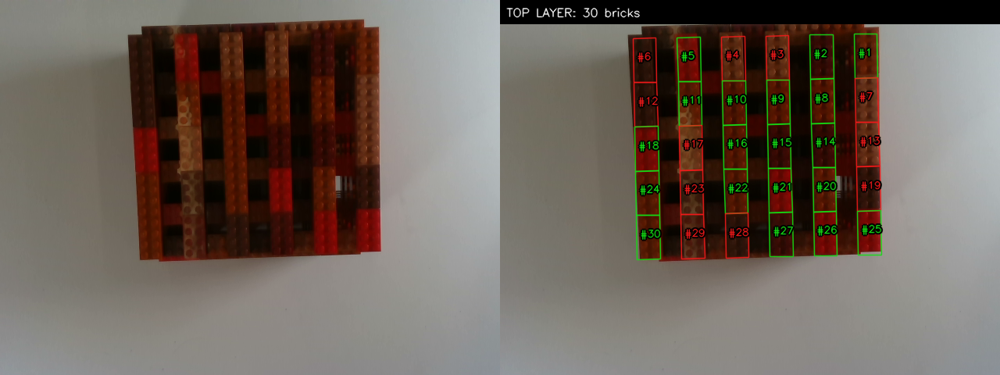
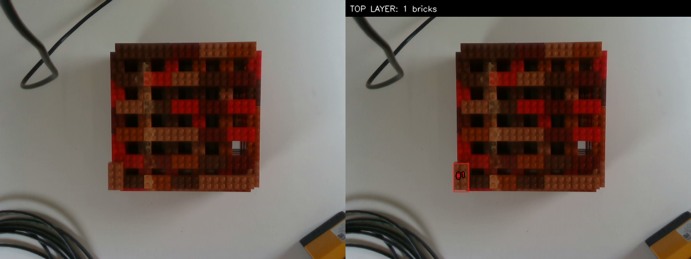

# Top-layer brick quality classifier

This folder contains the standalone good/bad classifier that runs after the
RGB-D top-layer detector. Segmentation and classification remain independent:
the classifier never loads SAM, never changes the detected boxes, and can run
on the CPU using saved `top_boxes.json` files.

The current quality rule is based on the known LEGO colours:

| LEGO colour | Element | Quality |
|---|---:|---|
| Red | 300121 | Good |
| Dark red | 6117418 | Good |
| Dark orange | 6487946 | Good |
| Medium nougat | 6135191 | Bad |
| Reddish brown | 4211201 | Bad |

## Architecture

```text
RGB frame + top_boxes.json
            │
            ├── Estimate white balance from neutral table pixels
            │
            └── For every oriented top-layer box
                    │
                    ├── Rasterize the oriented rectangle
                    ├── Erode 12% from its boundary
                    ├── Remove dark shadows and bright highlights
                    └── Measure robust median CIELAB colour
                                      │
                         Bounded scene Lab-offset correction
                                      │
                         Weighted distance to five prototypes
                                      │
                              LEGO colour class
                                      │
                   ┌──────────────────┴──────────────────┐
          medium nougat / reddish brown        remaining colours
                       BAD                          GOOD
                    red box                     green box
```

### Reliable colour extraction

The oriented box is eroded before measurement so neighbouring bricks, gaps,
and lower layers do not contaminate the colour. The darkest 15% and brightest
10% of interior pixels are removed to suppress stud shadows and specular
highlights. The median of the remaining pixels is considerably more stable
than a mean over the complete bounding box.

### Illumination correction

Neutral, moderately exposed pixels outside all brick boxes estimate the table
colour. Conservative RGB gains make this reference neutral. A second bounded
Lab offset is estimated jointly from all bricks in the frame. Lightness may
adapt more than chroma, preventing exposure changes from erasing actual colour
differences.

### Prototype decision

The classifier compares each corrected Lab measurement with five
camera-calibrated colour prototypes. The distance weights are:

```text
L*: 0.45    a*: 1.0    b*: 1.0
```

The nearest prototype supplies the colour and therefore the good/bad result.
The JSON output also retains the second-best class, distance margin, all class
distances, and a high/low confidence flag. The visualization always uses the
requested binary decision: green for good and red for bad.

## Run

The script requires Python, NumPy, Pillow, and OpenCV. The existing `sam3`
environment contains these dependencies, but the classifier itself does not
load SAM or require a GPU.

From the repository root:

```bash
conda run -n sam3 python classifier/classify_top_brick_quality.py \
  perception/sam3_detection/results_rgbd_topplane_v2 \
  --out classifier/results_rgbd_quality_v1
```

Important options:

| Option | Default | Meaning |
|---|---:|---|
| `--erosion-fraction` | 0.12 | fraction of the short brick side removed at the boundary |
| `--min-pixels` | 80 | minimum reliable pixels before falling back to the complete box |
| `--max-distance` | 35 | maximum weighted prototype distance for high confidence |
| `--min-margin` | 4 | required separation from the second-best class |

## Output

The complete 69-recording result set is stored in
[`results_rgbd_quality_v1/`](results_rgbd_quality_v1/), covering all 32
`data3` and 37 `data4` recordings.

Each `<dataset>/<recording>/<frame>/` folder contains:

| File | Content |
|---|---|
| `quality_result.png` | RGB image with thin red/green oriented boxes |
| `quality_comparison.png` | original image and classification side by side |
| `quality_boxes.json` | classification, confidence, Lab values, distances, white balance, and original box geometry |

The result root also contains `summary.json` and `summary.csv` with per-frame
brick, good, bad, and low-confidence counts.

## Examples

Dense 30-brick layer from `data4`:



Single remaining top brick from `data3`:



## Limitations

The method is a deterministic reference-colour classifier because no manually
labelled training set is available. Confidence values indicate ambiguity but
are not measured probabilities. Fixed exposure and white balance are still
recommended. If the camera, illumination, or physical brick batch changes
substantially, recalibrate the five Lab prototypes before relying on the
quality decision for robotic sorting.

## Brick poses for motion planning

[`export_brick_poses.py`](export_brick_poses.py) converts every classified box
into a 6-DoF brick pose. The translation is the median RGB-D top-surface centre.
The brick X axis follows its detected long side, Z is the fitted outward surface
normal, and Y completes a right-handed frame. Each pose is stored as XYZ,
quaternion, rotation matrix, and a homogeneous 4x4 transform.

```bash
conda run -n sam3 python classifier/export_brick_poses.py \
  classifier/results_rgbd_quality_v1
```

This writes `brick_poses.json` beside every `quality_boxes.json` and creates
`all_brick_poses.json` as an index over all recordings. The record also includes
quality, colour, detection confidence inputs, surface normal, approach direction,
an 80 mm pre-grasp point, and nominal 2x4 brick dimensions.

The exporter also writes a compact `camera_boxes.json` beside every classified
frame. It retains `center_pixel_xy` and `corners_pixel_xy` for traceability, but
adds the fitted physical cuboid in the RealSense optical frame:

- `top_face_center_camera_m`: graspable top-centre XYZ;
- `box_center_camera_m`: geometric volume-centre XYZ;
- `box_size_m`: long side, short side, and height;
- `box_rotation_camera`: 3x3 orientation matrix;
- `top_corners_camera_m`: four top-face XYZ corners;
- `bottom_corners_camera_m`: four bottom-face XYZ corners;
- `box_corners_camera_m`: all eight corners, top face first.

Coordinates are metres with camera convention `+x` right, `+y` down, and `+z`
forward. The cuboid uses the nominal physical 2x4 size 31.8 x 15.8 x 9.6 mm,
centred on the detected box-centre ray intersected with the fitted top plane.

The saved datasets do not contain a camera-to-robot hand-eye calibration, so
their poses are correctly identified as `camera_color_optical_frame` poses and
`robot_base_poses_available` is false. To produce robot-base poses, provide a
calibration JSON:

```json
{
  "frame": "panda_link0",
  "T_base_camera": [
    [1, 0, 0, 0],
    [0, 1, 0, 0],
    [0, 0, 1, 0],
    [0, 0, 0, 1]
  ]
}
```

The identity matrix above is only the schema example, not a valid calibration.
Run with `--camera-pose hand_eye.json` after calibration. The exporter will then
add `pose_base`, base-frame surface/approach directions, and the base-frame
pre-grasp position for every brick.

## Pose verification visualizations

[`visualize_brick_poses.py`](visualize_brick_poses.py) recreates the selected
physical top-surface pixels from the temporal-median depth and overlays the
grasp geometry. All 69 outputs are saved in [`viz_box/`](viz_box/). Each
`pose_comparison.png` contains the original RGB, top-layer segmentation, and
pose visualization from left to right. Lines are one pixel wide and the surface
overlay is translucent.

```bash
conda run -n sam3 python classifier/visualize_brick_poses.py \
  classifier/results_rgbd_quality_v1 \
  --out classifier/viz_box
```

Visualization colours:

| Colour | Meaning |
|---|---|
| Cyan translucent fill | measured depth pixels on the selected physical top surface |
| Green outline | brick classified as good |
| Red outline | brick classified as bad |
| Yellow cross | exact top-surface grasp centre from the box-centre ray/plane intersection |
| Blue line | brick +X axis, following its long side |
| Magenta arrow | gripper approach direction toward the brick |
| White circle | 80 mm pre-grasp point projected into the image |

Each visualization folder also contains `visualization.json`, which records the
legend, input sources, top-surface tolerance, and brick count. The root
`viz_box/summary.json` indexes the complete set.
